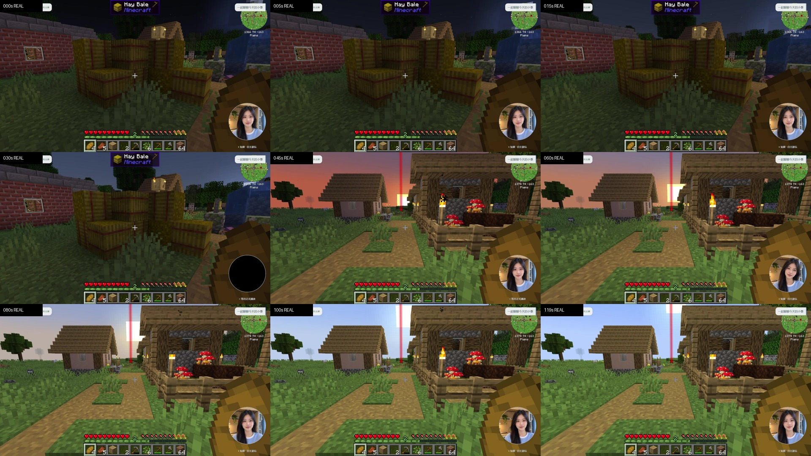
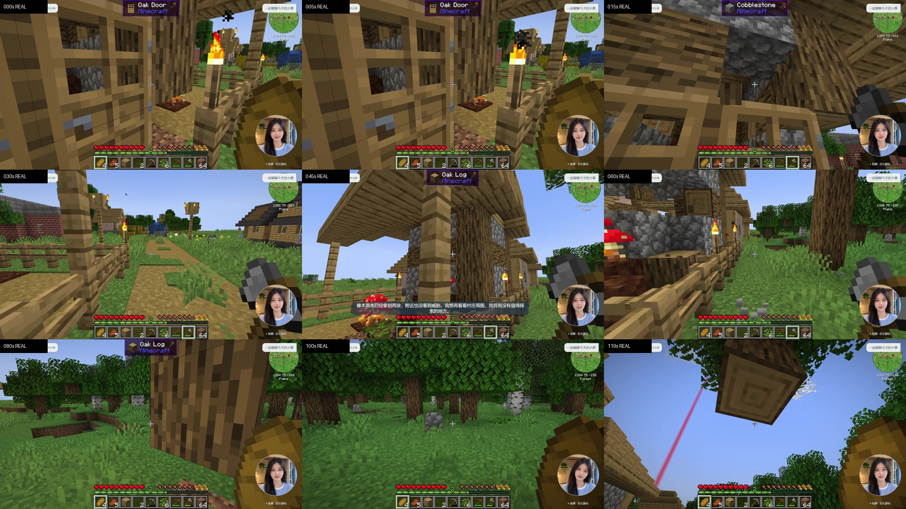

# 口播等待恢复与107运行复核

编号：`MC-20261104-107`；日期：2026-11-04；分支：`mc`。

3080远控恢复，107c已完成新的游戏观察、正常保存和独立收尾核对。107c轮新增观察600.896秒，AUTO采样569项、PAUSED采样3项；核验非导航成果5项、正式口播完成11项。正常保存已核对，最终自有服务全部关闭。115项资源采样中，官方源指标按时间去重为110项；FPS最低0.00、中位24.87；音频欠载计数从1升到2，不作为连续稳定验收。Luna视觉状态按帧/终态去重为24成功、5失败，不代表视觉准确率。5项成果分别为采集圆石2个，以及4次原木采集、共取得5个原木；另有3次导航成功，单独统计。

本轮修复未派发口播因短时游戏状态断更被直接丢弃：在原有效期内等待新鲜状态，再重新校验；已派发请求失去新鲜状态仍取消，不重播。3080专项69/69、核心423/423通过，二者重叠不相加。新增两段原速连续120秒官方本地录像：固定开场片段正式完成回执1项，固定末段片段4项；均为1920×1080/30FPS编码及原录音轨。30FPS编码不代表来源连续30FPS。开场等待较长，约30秒处可见人物圆形区域短暂黑屏；片段可见待机歪头、眨眼与说话口型。末段可见砍木和移动，原木目标也包括村屋立柱，资源选择与持续节目目标仍需改善。不能把采样AUTO、文件编码成功、非静音或正式回执当作整套节目质量验收。

同时补齐106轮中断审计：256项采样、末次采样距开始276.242秒；核验7项非导航成果，其中进食1、面包制作4、干草块采集1、小麦制作1。一次实际死亡后自动复活，19类物品及数量一致；keepInventory=true。取回的视觉状态去重为12成功/1失败，4张原生JPEG与描述作定性复核。106轮正式口播完成0，守护清理FAULTED，正常最终保存未证实，不能补记600秒通过。正式0/68、新人物0/100、117项冻结待办保留。

表1：本轮实际实现与验证。

| 编号 | 内容 | 已核对结果与边界 |
| --- | --- | --- |
| I1218 | 3080远控恢复 | 新控制会话ready，实际桌面/文件读取恢复；本机游戏、模型和应用测试0。 |
| I1219 | 106退出与账本复核 | 六项自有服务全关；旧任务保留accepted/unknown历史，但有持久never_admitted封锁，未决接收为空。 |
| I1220 | 106实际成果 | 7项非导航任务均核对最新原生终态及同一世界会话；11成功包含4导航，不混作11项生产成果。 |
| I1221 | 死亡不掉落实证 | 一次死亡→自动普通复活；死亡前、死亡中、复活后19类库存及数量相同；测试未给物品、传送或下达游戏目标。 |
| I1222 | Luna视觉复核 | 去重12成功/1失败；4张实际JPEG与核心场景对象定性相符，不声称100%准确率。 |
| I1223 | 未派发口播等待 | 只对pending且没有request_id的候选，在原有效期内等待新鲜观测，不调用模型或媒体。 |
| I1224 | 原有结束条件 | 到期、来源隐藏/删除、世界或节目变化仍结束候选；已提交语音状态过期仍取消，恢复后不自动重播。 |
| I1225 | 3080协议检查 | 新增5项覆盖；专项69/69、核心423/423，0失败/跳过/待做；均为远端CPU协议夹具，套件重叠。 |
| I1226 | 安装与启动 | 检查过的0e7742…源快照更新原安装，保留私有策略/状态/世界；服务启动通过。 |
| I1227 | 新增实机验证 | 107c轮新增观察600.896秒，AUTO采样569项、PAUSED采样3项；核验非导航成果5项、正式口播完成11项。正常保存已核对，最终自有服务全部关闭。115项资源采样中，官方源指标按时间去重为110项；FPS最低0.00、中位24.87；音频欠载计数从1升到2，不作为连续稳定验收。Luna视觉状态按帧/终态去重为24成功、5失败，不代表视觉准确率。5项成果分别为采集圆石2个，以及4次原木采集、共取得5个原木；另有3次导航成功，单独统计。 |
| I1228 | 文档及发布 | 同步中英文README、编号报告、进度JSON、全部D01–D15待办；源码79f635c已推送核对，文档发布另记。 |
| I1229 | 录制与游戏焦点 | 107b首次实测因切换到直播姬录制界面使游戏失焦，3次AUTO请求被拒绝，未产生自主窗口；已正常保存并关闭。107c改为先录制、后启动游戏，未取消失焦保护。 |
| I1230 | 官方实录 | 新增两段原速连续120秒官方本地录像：固定开场片段正式完成回执1项，固定末段片段4项；均为1920×1080/30FPS编码及原录音轨。30FPS编码不代表来源连续30FPS。开场等待较长，约30秒处可见人物圆形区域短暂黑屏；片段可见待机歪头、眨眼与说话口型。末段可见砍木和移动，原木目标也包括村屋立柱，资源选择与持续节目目标仍需改善。不能把采样AUTO、文件编码成功、非静音或正式回执当作整套节目质量验收。 |
| I1231 | 独立收尾复核 | 独立检查通过，未决接收0项；原官方客户端与规则备份保留，私有策略摘要未变。 |

106的完整观察结果直到远控恢复后才取回。原256项采样最后一项位于开始后276.242秒，原程序和其收尾均在等新鲜状态时超时。守护最终为UNEXPECTED_ROOT_EXIT/FAULTED；旧的105正常退出收据属于另一游戏所有者，不能用于106。原存档已有引擎自动保存记录，但不据此声称中断前最后状态已正常保存。未修改106冻结报告来抹去当时证据缺失。

源码修复范围为未派发队列。候选等待期间不续期、不生成新请求，不扩大2000ms游戏观察门槛；状态恢复后仍重新检查来源、世界及节目。模型调用、媒体提交和正式完成继续走既有校验。任何已提交或可能播出的语音均不以本修复重试，防止重复发声。

107首个安装辅助程序把预期变更列表误限为两份实现文件；实际还包含106之后已发布的两份README。来源整包更新已完成，服务未启动。保留该失败结果，后续辅助程序复核完整四文件差异后从安装准备继续，没有重复覆盖源、伪造准备记录或重新写世界。

107b首次实测因切换到直播姬录制界面使游戏失焦，3次AUTO请求被拒绝，未产生自主窗口；已正常保存并关闭。107c改为先录制、后启动游戏，未取消失焦保护。

107b正常清理期间接口断开，不构成106根进程异常退出的再次复现；106根因仍保留待查。106遗留的RECOVERING内部节目会话已在107启动后按正式结束接口及当前修订号关闭，不追认106正常最终保存。

新增两段原速连续120秒官方本地录像：固定开场片段正式完成回执1项，固定末段片段4项；均为1920×1080/30FPS编码及原录音轨。30FPS编码不代表来源连续30FPS。 开场片段从AUTO开始10秒后取连续120秒；补充片段固定取观察结束前5秒为终点的连续120秒。两段均无蒙太奇、加速或补配音，开场片段保留。原始全长录像保留于3080。开场等待较长，约30秒处可见人物圆形区域短暂黑屏；片段可见待机歪头、眨眼与说话口型。末段可见砍木和移动，原木目标也包括村屋立柱，资源选择与持续节目目标仍需改善。不能把采样AUTO、文件编码成功、非静音或正式回执当作整套节目质量验收。

开场片段内没有非导航成果，正式完成口播1条；末段片段内有3项原木采集成果，正式完成口播4条。完整观察窗口的5项成果不能混作每一段120秒的成果。本机已取回并核对两份MP4的字节数和SHA-256；媒体文件保留于`outputs/mc-validation/round-106/remote-evidence/`，不随Git发布，具体文件名及摘要见机器证据。

[开场人物48帧](../../media/mc-round-107/opening-avatar-contact.jpg) · [末段人物48帧](../../media/mc-round-107/late-avatar-contact.jpg)。这些为3080从原始录像抽取的实际帧，格内时间仅为索引；没有修补缺帧。

表2：完整范围剩余事项。

| 编号 | 完整剩余事项 |
| --- | --- |
| D01 | 完整安装包、许可及干净Windows重建、来源与副本、缓存/回退、冷/热启动、共享资源恢复；必需服务启动不替代完整交付。106中断后的自有服务全关已确认，正常最终保存仍不能追认。 |
| D02 | 真实模组方块/实体/容器/维度、断连/换世界/死亡地形、墓碑/重连、后续联机兼容；接收封锁须跨场和断电恢复长期验证。 |
| D03 | 普通PvE、夜间多敌人、饥饿回血、复活、GUI、水/熔岩/氧气、租约及长期停止。已有一次死亡不掉落实机证据，尚不等于持续生存通过；不改变其他规则。 |
| D04 | 工具/工作站、模组多配方、持续食物、狩猎烹饪、种植钓鱼、储物、耐久、建造及连续生存。106的采集→小麦→面包及进食有真实回执；107c取得圆石2、原木5，原木目标含村屋立柱，资源选择与持续循环待改进。 |
| D05 | 持续有效目标、Mindcraft依赖求解、Luna决策、工作站/弹幕并发、预算/取消、事实与未知结果恢复的长时闭环；一次旧请求封锁恢复不替代持续节目。 |
| D06 | 595139真实弹幕/礼物/SC、建议/投票/撤回/反馈、断线补偿及展示；公开采集接通不替代真实观众样本，用户当前不能发送样本。 |
| D07 | 记忆纠错/遗忘/删除、跨日、备份恢复、唯一写者隔离、配额延后与真实弹幕语义验收；保留既有配额限制。 |
| D08 | 全端启停/任务/资源/音量/诊断/恢复、方案切换、并发/手机、真实消息左右换边与队列保留及完整后台验收。 |
| D09 | 持续有效节目、自然及时口播、供帧/重缓冲、真实弹幕、手机及完整官方横屏验收。已有两段原速120秒实录；107c正式完成11项，但开场等待、人物短黑屏、口播过期与取消仍存在。 |
| D10 | 两套各2段待机+48动作，共100段新素材及索引、口型、圆形遮罩和接缝；新包0/100，原female-A素材保留。 |
| D11 | 游戏/人物语音/BGM混音闪避、F07实际故障接替、唯一有声音源及长期稳定。107c有11条正式完成和实录音轨，仍发生authority_lost、欠载累计计数1→2及口播取消；本次未验收游戏声/BGM混音。 |
| D12 | 真实原生JPEG至Luna准确率、模组物品/危险/OCR/装备、帧绑定、超时与共享负载调度；106的12成功/1失败及4帧定性检查、107c的24成功/5失败，均不替代系统准确率。 |
| D13 | 公开状态核对、独立观众CDN音画及端到端时延；没有公开开播授权，保持未执行。 |
| D14 | 冷/热启动、FTB、日志持续上限、CPU/GPU/内存、来源绑定供帧、4小时含60分钟稳定段及异常停止。107c源FPS按时间去重110项，最低0、中位约24.87，仍有短黑屏、欠载及3项PAUSED采样；106根进程退出原因未闭环。 |
| D15 | 正式0/68、24组合/12场景/8发布门、跨场次日、干净安装/回滚及20项交接；117项冻结待办保留，一份完整集成交付不降低范围。 |

源码：[79f635c](https://github.com/wikigsroom/Ai-Talk-Streamer/commit/79f635c6cc2bf776e04e2908ce2ab64db1bbc242)；[机器证据](../../evidence/mc-runtime-round-107.json)；[完整进度](实现进度.md)。
