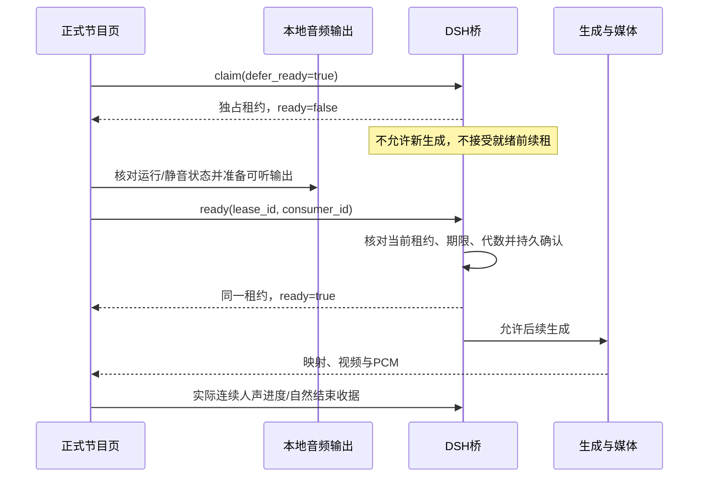

# 正式播放就绪握手与故障诊断

对应实现候选028。完整范围和一次交接要求仍以[12章总计划](12-一次完整交付总计划.md)及[08章](08-完整交付规划.md)为准。本文说明正式音频启动与MC连接故障的实际代码契约；本地协议/浏览器检查不替代真实MC、模型推理、官方客户端和独立观众验收。

## 1. 可复现问题及修正

正式节目页原先等待播放权申请返回后才接通可听输出。服务器已授予播放权时，生成调度可能立即开始；申请响应在网络中延迟，前350ms人声已经到达仍静音的页面。样本映射从非零位置开始，连续有效人声前缀无法成立，最终不能产生有效完成收据。

028的原始浏览器复现保持350ms申请延迟，记录到画面和音频时钟已推进、没有缺包或解码错误，但该句`enqueued=0`、`played=0`、`lost=true`、无首样本。修改后同一延迟条件重新核对首个有效播放收据。原始结果保留在`outputs/mc-validation/round-028/browser-final-attempt1-result.json`和对应清理记录。

027的首次PCM等待超时没有记录到同等首样本信息，不能据上述复现断言两次必为同一根因。027连接新鲜快照等待超时同样继续跟踪；本轮新增诊断用于保存更强的后续证据。

## 2. 先保留播放权，再确认本地输出就绪

准备状态已占有唯一消费者名额，另一个页面不能抢走它。准备状态不满足`authority_ready`，广播就绪和新请求激活都保持阻挡；普通心跳不能给准备租约续命。按原策略到期后可以重新申请，旧准备确认会被拒绝。

客户端在发出ready之前完成本地音频准备。因此即使ready响应晚于首段PCM，本地也能保留有效前缀；在ready完成前仍不发送正式进度，字幕播放权也尚未开启。收到确认后再次核对页面/媒体实例、静音与AudioContext；关闭、换连接、静音或暂停后返回的响应不能重新开启声音或字幕。

## 3. 公共HTTP与兼容规则

这些是既有DSH播放接口的扩展，继续遵守项目免应用登录要求。它们位于MC/Room OpenAPI的45项操作之外，本轮没有将DSH接口冒计入该操作数量。

| 接口 | 请求与约束 | 结果 |
|---|---|---|
| `POST /api/dsh/playback/claim` | 对象；只接收`broadcast_id`、`consumer_id`及可选布尔`replace`、`defer_ready`；ID长度8–100，未知字段/错误类型拒绝 | 原租约字段、新增布尔`ready`及既有`playback_timing` |
| `POST /api/dsh/playback/ready` | 精确两个字段：`lease_id`、`consumer_id`，均为长度8–100的字符串 | 返回同一广播/消费者/租约/运行代/播放代及`ready=true` |
| `POST /api/dsh/playback/heartbeat` | 沿用既有契约；当前租约必须已就绪 | 更新期限；准备状态、过期或错误消费者被拒绝 |
| `POST /api/dsh/playback/receipt` | 沿用实际连续PCM、自然完成和运行/播放/语音代绑定 | 未就绪或失效播放权无法推进回应完成 |

未提供`defer_ready`的旧客户端沿用立即就绪语义，正常旧申请和收据仍须回归。重复准备申请返回同一租约和代数，不隐式升级；重复ready幂等，不重复事件，也不额外延长期限。显式replace沿用原取消和运行代更新。错误消费者、旧替换租约、重启前租约和到期确认返回冲突。

每个人物房间在既有`runtime_meta`保存一条就绪证明，绑定schema1、ready、lease_id、broadcast_id、consumer_id、runtime_epoch、authority_epoch。重复申请更新同一个键，不按每次申请新增记录。申请/确认的证明、租约和事件同事务提交；失败回滚。

每次新申请都会保存证明，进程重启撤销旧租约并清除当前房间证明，因此没有“缺少证明自动视为已就绪”的兼容分支。证明缺失时就绪为false，合法当前消费者可以再次确认；JSON损坏或绑定不匹配返回503 `PLAYBACK_READINESS_INVALID`，不能生成/续租/确认。操作者核对原因后显式替换可形成新的证明。

## 4. 客户端期限、迟到和关闭

[DSHPlayback](../../../web/dsh-playback.js)为HTTP设置6秒上限及AbortController，同时使用独立终止Promise处理忽略abort的请求实现。关闭中止所有等待，清定时器/映射并取消旧语音。申请版本和原租约对象绑定拒绝乱序返回；新确认必须匹配五项身份及正整数代数。

准备状态不发送心跳或播放进度。就绪后仍按服务端期限和Room时钟换算本地单调期限；网络沉默也会在本地失权。关闭不会伪造服务器立即撤销的事实，服务器按实际请求、心跳与期限收束租约。

[正式节目](../../../web/mc-programme.js)继续坚持一个正式消费者；已有其他消费者时等待，不自动replace。预览不创建正式DSH消费者；Room音量/静音、页面关闭、流重置与取消继续走原实际音频清理路径。真实单路游戏/BGM/O07/F07、全部遗留播放器排他及官方源仍须联合验收。

## 5. 游戏连接和存储故障诊断

[GameManager](../../../backend/game/manager.mjs)的既有health增加以下有界内存记录，最多各保留一份，不建立无界错误历史：

| 字段 | 含义 |
|---|---|
| `last_fault` | 第一份存储/所有权故障，保留原始触发阶段而不被后续断线覆盖 |
| `last_protocol_error` | 最近协议拒绝，与存储故障分开 |
| `last_disconnect` | 最近断线时刻与固定原因 |
| `last_bridge_message` | 最近桥消息的阶段、类型及实际处理耗时 |
| `slowest_bridge_message` | 本进程最慢桥消息的同类记录 |

故障字段仅含schema、时刻、固定调用阶段、受限格式错误码、数字SQLite码、已观测序号和已验证帧类型；不包含异常message/stack、SQL、私有路径或观众原文。桥处理耗时使用实际`performance.now()`，与测试注入的业务时钟分开。失败或处理达到250ms时推送更新；snapshot也携带当前health。

存储故障后撤销宿主租约、尝试发送暂停并关闭连接。该操作不冒认本地键鼠已经释放，实际释放由游戏端租约与输入链核验。后续状态/任务/控制操作沿用503阻挡；既有`GET /api/dsh/game/events`可在服务启用且未关闭时直接发送内存health，不读取故障数据库。因此刷新后台后仍可看到第一份原因。

[MC后台](../../../web/mc-control.html)新增“连接与故障记录”：正常/待连接/故障状态、面向操作者的恢复提示和折叠技术记录。详情通过textContent渲染。收到故障即使普通刷新失败也禁用AUTO，390px下不横向溢出。内存诊断随进程重启结束；完整持久日志、容量、跨进程trace和资源曲线仍属D14待办。

## 6. 连接夹具与验证边界

[连接夹具](../../../tests/game-fixture.mjs)区分hello_ack和首次新鲜快照。失败时在本轮独立目录保存唯一诊断JSON：当前内存health、状态年龄/序号/revision、连接状态、已收帧类型和请求序号；夹具清理不会删除该文件。不延长等待、不自动重发来掩盖失败；存储已故障或连接关闭时立即报告。

新增检查覆盖准备独占/过期/替换/重启/幂等、缺失与损坏证明、确认事务回滚、真实HTTP错误参数、客户端迟到/关闭/超时、350ms申请延迟、等待就绪时静音/关闭、协议与存储故障区分、首快照失败留证、故障后SSE及后台刷新/窄屏。全部本地执行结果、源码hash和浏览器清理见[028证据](../../evidence/mc-runtime-round-028.json)。

本轮没有启动真实MC、人物/TTS/视觉模型、官方客户端、公开广播或4090设备。Node→Java无头协议只沿用已存构建物，不冒认重新构建或实机运行。实际验收仍0/68，新人物仍0/100；历史时延/负载与原027失败按原范围继续跟踪。
