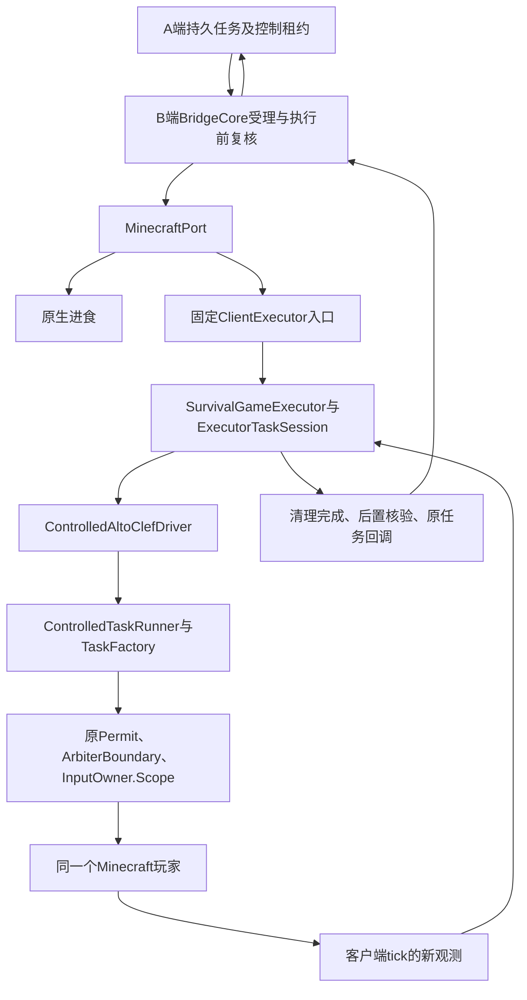

# 真实玩家执行器接入与效果核验

[完整蓝图](09-全端实现蓝图.md) · [游戏协议](02-游戏桥与控制协议.md) · [生存构建](完整生存执行档构建与任务入口.md) · [实现进度](实现进度.md)

本说明记录第015轮将生存候选接到同一真实玩家的代码路径。它是完整D02–D04实现的一部分，完整生存、GUI、配方/基地、实机输入及统一交付要求继续保留。候选的Fabric preLaunch仍无条件拒绝，未安装或启动游戏。

## 1. 实际调用链

原有GamePort协议、任务ID、B端持久受理和结果回传继续使用。新增入口没有建立Mineflayer玩家、第二个控制仲裁器、模型进程、人格或声音消费者。网络与模型仍不在游戏tick中等待。

## 2. 入口、来源与能力声明

| 项目 | 当前实现 |
|---|---|
| 入口协议 | 原生桥提供ClientExecutor，Fabric自定义入口名ai_talk_streamer_executor |
| 候选注册 | 固定AltoClef源码补丁的fabric.mod.json注册SurvivalGameExecutor，原preLaunch和main入口保留 |
| 选择 | 同一安装最多一个入口；核对提供者altoclef和固定1.21.1-0.19+ats.1版本 |
| 寻路来源 | 原生桥发现独立Baritone时仍拒绝自动技能；已绑定候选只接受其包含的Baritone来源 |
| 源码能力 | 候选profile为altoclef_trial，当前接通navigate、gather；原生eat和cancel沿用原路 |
| 完整能力 | basic_pve、survival_rules、resource_chains仍为false；craft和return_base尚不进入该入口的能力集合 |
| 实际启用 | 生存候选仍被无条件预启动阻挡；A端enabled_skills默认空，不因新类或JVM通过而自动启用 |

入口的元数据核对是安装一致性检查，不是对同一JVM任意Mod的隔离保证。正式源码、包hash、依赖来源和设备运行锁仍由D01/D03/D04验收；不能改版本字符串或删阻挡来冒充已接受的完整执行档。

## 3. 开始、tick、结束与取消

MinecraftPort先在游戏线程重新检查实际界面、绑定状态及技能前置条件，再将原任务、最新观测、ControlArbiter和InputOwner交给候选。ExecutorTaskSession复制任务和起始观测，核对安装、boot、稳定世界、世界会话、epoch及原Permit；缺少初始观测在调用驱动前拒绝。

SurvivalGameExecutor将相同task/controller/lease/world/epoch传给SurvivalAuthority.Context，ArbiterBoundary绑定实际InputOwner.Scope。ControlledTaskFactory仅在该根作用域内构造任务，驱动逐tick通过原权限运行，不重新取得后来的租约。

| 状态变化 | 行为 |
|---|---|
| 新观测且原上下文有效 | 推进实际驱动一次 |
| 重复或倒退观测序号 | 不重复推进驱动，不产生完成证据 |
| 世界/boot/epoch变化、租约失效或离开gameplay | 先取消及清理，再回报cancelled/unknown；超时为failed/unknown |
| 上游报告结束 | 原驱动先停止树、清理路径/覆盖/脉冲/订阅和原输入；随后只登记待核验 |
| 后续更新观测到达 | 核对位置或库存，形成带原会话及该seq的结果证据 |
| 清理失败 | 保留当前任务/根，阻止替代任务；后续取消可以重试，不提前回报已完成 |

最终回调在旧任务清理块之外交付；即使调用方在回调中启动下一任务并抛错，也不能回到旧任务清理路径去停止新任务。迟到或重复的旧完成信号、工作线程发来的完成信号均不能借用新任务的权限。

## 4. 后置条件的准确含义

上游任务结束不是succeeded证据。最终观测必须严格晚于产生完成信号的那次tick，并仍属于原安装、boot、稳定世界、会话和epoch。所有结果通过已有B任务账本及可靠回报路径发送。

| 目标 | 当前后置核验 | 保留的边界 |
|---|---|---|
| navigate | 当前玩家位置与目标同维度，三轴距离不超过请求radius | 缺玩家/位置、维度不同或未到达均不成功；实际路由和危险处理仍待MC验证 |
| gather | 按精确物品ID汇总可观测库存，after−before达到请求count | count表示目标新增量；通过InventoryTarget换算内部总量。数量不足但确有增加为failed/partial，其余为failed/unknown |
| craft | 本入口拒绝 | 普通库存增加不能证明实际合成；仍需预期GUI、配方选择/组件、材料和真实craft_result证据 |
| return_base | 本入口拒绝 | 仍需A/B基地ID、世界、修订及固定目标的可靠绑定，不能仅注入一组坐标 |

例如起始有3根原木、gather.count为4时，要求额外采集4根，内部目标为7；最终只有4时为partial。第015轮把外部count误写为目标总量，第016轮已按原协议纠正，旧证据保留为历史。库存变化不夸大为“已挖掘某个方块”，完整推导及合成材料准备见[采集合成数量与材料分配](采集合成数量与材料分配.md)。

原生eat继续使用食物堆减少且饱食增加的专门核验。本轮没有将该证据借给equip/activate、合成、PvE或其他尚未绑定操作。

## 5. 检查与产物证据

| 检查入口 | 证明范围 |
|---|---|
| [ExecutorTaskSessionTest](../../../game-adapters/minecraft/fabric/src/test/java/dev/aitalkstreamer/mc/core/ExecutorTaskSessionTest.java) | 实际会话类/仲裁器；26项位置/库存增量、时序、取消、失败保留、旧回调和消费者重入检查，游戏观测为夹具 |
| [PortTaskIntegrationTest](../../../game-adapters/minecraft/survival/src/test/java/dev/aitalkstreamer/mc/survival/PortTaskIntegrationTest.java) | 新会话＋实际ControlledTaskRunner＋原生ArbiterBoundary/InputLedger的7项组合检查，含数量换算；游戏任务效果仍为夹具 |
| [原生构建](../../../scripts/mc_build_fabric.ps1) | 原生桥编译、JVM与Java↔Node协议进程检查，不启动MC |
| [准备脚本](../../../scripts/mc_prepare_survival.py) | 离线使用固定源/依赖，生成并逐文件核对24项补丁，不下载模型 |
| [生存产物核验](../../../scripts/mc_check_survival_build.py) | JAR版本/入口、实际接口类、源/包、变换和测试收据；仍标不可安装候选 |

本轮一次中间跨进程检查在预期进入running前以GAME_MODE_BLOCKED结束，状态已停控。保留该失败，不据约3秒的等待直接断言是磁盘或GC。新增本地诊断分别记录账本事务、受理/任务提交、actor间隔、游戏观测间隔和收件等待，以及AUTO后的首次/最后停控原因；查询使用原子计数，不读磁盘或取得SQLite锁。新增JournalTimingTest实际持有账本监视锁并从另一线程读取诊断，确认诊断不会等待该锁。协议/租约/新鲜度期限没有放宽。

HeadlessBridge的stats与跨进程失败报告携带这些脱敏指标；没有把此内部诊断当作新的公开游戏接口。后续整组通过也不能单独证明间歇性停控及此前高I/O成因已消除，D14仍保留该项。

本轮最终数量、日志、包hash和静态指令清单见[第015轮证据](../../evidence/mc-runtime-round-015.json)。旧Node与浏览器结果只在源码hash一致时沿用，不计本轮执行。清理检查只核对本任务的夹具进程，保留其他应用与GPU工作。

## 6. 完整版本的继续关闭条件

仍须把预期GUI、全部输入/视角/网络/线程写点、MinecraftPort完整生存能力、合成和基地上下文、物品使用、PvE/补给/危险/资源链接齐，并完成物理输入恢复及真实任务证据。原始完整目标、68项、20次接管、4小时、次日和100段人物素材均未删减。

原生编译、组合JVM和协议进程均不证明实际Fabric入口初始化、Mixin注入、MC世界效果、真实模型、官方直播姬或观众音画。全部实机项继续按not_run管理；此说明不构成单独发布或完整生存能力验收。
