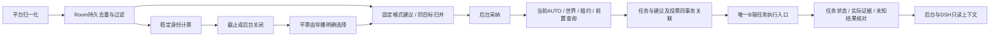

# 观众建议、投票与任务闭环

[技术入口](README.md) · [DSH与弹幕](03-DSH弹幕与记忆.md) · [接口与数据](04-接口与数据.md) · [完整交付规划](08-完整交付规划.md)

本篇记录mc分支已实现的源码路径及本地检查边界。整套系统仍按一个完整版本交付；工程检查不是分批产品交付，也不替代真实MC、平台、推理、播放或68项联合验收。

## 1. 实际处理路径

源码位于backend/platforms/events.mjs、backend/room/manager.mjs、backend/game/suggestions.mjs、votes.mjs、tasks.mjs、manager.mjs及backend/dsh-bridge/game-tools.mjs。不引入第二个人格、独立模型队列、Humanity写入者或音视频播放器。

互动房间读取现有PlatformManager配置中`platforms.bilibili.room_id`，不读取DSH的characterRoom命名空间。尚未保存实际平台房间时，不创建投票或观众建议。平台切换房间后，旧房间活动投票取消、待处理建议过期，当前列表与上下文不混入其他房间。这里只接B站MC互动，不能凭相同数字房间号把其他平台事件计入。

## 2. 建议输入与归并

当前确定性解析支持以下完整格式；非完整匹配继续作为普通聊天，不执行代码或调用模型解析任意命令。

| 观众发送 | 固定目标 |
|---|---|
| `建议 采集 minecraft:oak_log 4` | gather，指定物品与数量 |
| `建议 合成 minecraft:oak_planks 4` | craft，指定物品与数量 |
| `建议 进食 minecraft:apple` | use_item / eat |
| `建议 回基地` | 当前世界实际登记的活动基地；没有基地时不产生该候选 |

数量1–4096，物品使用namespaced ID；不从观众文本更改世界、模式、租约或技能白名单。自然语言聊天仍由原有对话流程处理；自由文本语义映射及其消歧尚未实现，不能把这四类格式称为任意语言控制。

接收前要求：已启用游戏、当前新鲜观测、B站及所选房间、未隐藏/未标记测试、event_key有效、文本不超过1500字符、occurred_at和received_at均为有限时间。事件最大年龄30秒，未来最多2秒。旧重连留言不能重新成为新建议。

同一当前会话、房间、完全相同goal的proposed建议合并；support_count表示合并留言数量，**不是独立人数**。source_event_ids最多32项，保留最近来源；最多64项未结束候选。合并增加revision，不延长最初120秒有效期。采纳后冻结该建议的来源与目标，后续同主题留言产生新候选，避免后台审核期间内容悄悄变化。

GameStore只复制来源ID、结构化goal、计数与来源类别，不复制原文、昵称或稳定观众身份。短时audience_receipt与候选同事务写入，保存60秒、最多4096项；去重事实仍以既有平台/Room持久去重为第一入口。待处理容量达到上限时不产生新主题，已有proposed主题仍可合并。完整历史保留/清理预算仍属D07/D14未完事项。

## 3. 审核、执行与故障

decision使用request_id幂等和expected_revision核对。accept只转为accepted；reject和cancel保留原因。已过期、换世界、已关闭或修订冲突均拒绝。采纳、前置查询结束及最终任务关联时，重新读取Room消息的隐藏状态和当前屏蔽规则；至少一个保留来源仍有效，才允许以该建议建立新任务。旧版无来源的候选可保留历史审核，但不能据其发起观众任务。

`POST /suggestions/{id}/dispatch`受理SuggestionDispatch，返回kind=audience的Operation。此操作不切换模式：要求当前AUTO、automation_ready、租约、boot、世界、控制代数、无活动任务，再发只读check_action。待核验并发为1，总期限7秒；控制/世界/boot变化会取消读查询，迟到allowed结果不会恢复动作。

查询成功后重新读取当前事实，确认仍允许、建议版本/目标/来源未变，再调用普通TaskService.start。最终仍检查配置与B能力的交集、物品用途、当前维度和游戏界面；B仍按自身控制权与事实核验实际副作用。

TaskCreate的可选suggestion_ref只包含suggestion_id及expected_revision。A在同一SQLite事务中保存任务、任务幂等记录、建议converted/task_id、关联投票task_id，再向B发送task_start。若关联核验失败，整笔回滚；不会残留未关联的已受理任务。B任务正文继续保留原结构与权威version，不加入A端建议字段。

Operation成功仅表示A已建立任务并尝试派发，result.submission为accepted_locally、效果仍unknown；任务accepted/running/succeeded分别由既有账本与证据解释。发送失败时保留已提交关联和task_id，结果标dispatch_unknown并进入任务恢复核对，不能换请求ID重放同一建议。宿主重启不续跑旧操作；原请求重试返回原Operation，converted建议不能再次建立任务。

## 4. 投票生命周期

VoteCreate固定2–5个唯一option_id及goal，时长30–120秒，当前安装最多一场活动投票。已创建选项不可修改；后台不能用更改标签偷换goal。

只认完整`#选项ID`或`投票 选项ID`，要求稳定user_key、event_key、当前B站房间、未隐藏/未测试及有效双时间。发生时间必须处于本次投票创建到截止之间，最大事件年龄30秒、未来最多2秒。SQL主键vote_id/user_key限制一人一票，event_id唯一限制重复事件。昵称不是身份；SC没有额外权重。

计票只增加tally_version；关闭/取消/明确选择增加revision。截止冻结计数；最高票不唯一时winning_option_id保持空，导播只能从最高票选项中明确选择。全零也保留平票事实；界面及审计记录为导播选择，不伪造观众支持。

`POST /votes/{id}/suggestion`只接已经关闭且结果明确的当前世界/房间投票，并限制结果时效。首次请求在同一事务中生成proposed建议及Vote.suggestion_id，重复请求返回同一建议。它不会自动采纳或执行。采纳后仍经上一节相同入口，最终Vote、Suggestion与Task可以按ID核对。

当前采集器的SC继续保留notice_kind文本。金额、真实舰长/房管、表情及删除指令还没有贯穿Python输出、Room白名单和全链路；不得由昵称或文本推断权限。投票后隐藏/删除导致的撤票、个人删除联动及关闭24小时后的身份去除尚未实现，仍需完成D06/D07；不能宣称该部分已验收。

## 5. DSH与结果反馈

新增只读工具game_get_audience；game_get_state同时附带audience。摘要上限16项建议、3场投票、16项任务反馈，每项最多8条证据；不公开选民身份。server_time用于显示有效期，避免浏览器本机时钟改变审核判断。

game_start_task新增可选suggestion_id；使用该来源时固定goal必须完全一致，宿主把当前审核revision写入suggestion_ref。共享规划器只提供有效、来源仍可用的accepted候选，并要求执行候选时明确关联ID。口播用途可读互动事实；只有game_plan用途且当前world/epoch匹配时可调用动作工具；私人聊天仍无动作权限。

反馈从现有TaskService.get实时投影，包括B任务state/version、effect_status、证据、独立recovery及disposition。失败且partial必须保留；宿主中断不伪造B失败，人工结束未知也不改成成功。

022候选增加[任务结果与公开口播](任务结果与公开口播.md)：真实任务终态进入有界回应队列，speech_status投影实际候选及请求生命周期；只有有效正式PCM完成证明才为answered。反馈附narration_id、speech_request_id、speech_reason及speech_completion_event_seq，无候选时为not_scheduled。后台分别显示任务结果与回应状态，partial仍保留。播前事实复核、过期/取消及重启边界已有协议和浏览器检查；真实DSH渠道/MC/人物/正式输出、完整调度和Humanity删除联动仍须在D05/D07/D09/D11整链验收，不能根据任务完成声称观众已听到。

## 6. 接口、数据与后台

| 接口/字段 | 已实现行为 |
|---|---|
| GET `/api/dsh/game/audience` | 当前房间/会话的有界互动摘要与任务反馈 |
| GET `/suggestions`、GET `/votes` | 当前实际B站房间和世界会话分页；无选民明细 |
| POST `/suggestions/{id}/decision` | CAS审核、拒绝、取消 |
| POST `/suggestions/{id}/dispatch` | 幂等异步核验；成功后查询关联Task的真实结果 |
| POST `/votes`、POST `/votes/{id}/close` | 固定选项创建、结束、取消、平票明确选择 |
| POST `/votes/{id}/suggestion` | 幂等生成待审核建议 |
| Suggestion.origin / support_count | 平台、房间、来源种类/投票ID及合并留言数 |
| TaskCreate.suggestion_ref | A端事务关联依据，B任务正文不复制 |

表中省略前缀的接口均在/api/dsh/game下。权威Schema/OpenAPI由contracts/build_contracts.py生成；当前业务版本1.5.0，WS1.0，SQLite仍schema3，新增对象使用现有objects集合，无新SQL主版本迁移。

`/mc-control`沿用既定浅色导播台、键盘焦点及390px响应布局，增加观众一起玩区域：候选归并数量、审核原因、待处理/全部记录、执行检查、实际反馈及任务定位；投票编辑2–5个全部固定goal类型、可见票数、结束/取消、平票选择与结果生成建议。关闭浏览器不取消已经受理的任务；游戏侧控制与租约继续决定执行。

页面只把外部标签/原因当纯文本写入DOM，不新增外部请求、登录、播放器或声音。正式1920×1080节目布局、左右弹幕控制和冻结布局JSON不变；此页是管理界面，不能作为完整横屏节目运行验收。

## 7. 验证与未完成范围

本轮确切检查、原生JAR/Schema哈希、失败记录及浏览器清理状态见[第007轮证据](../../evidence/mc-runtime-round-007.json)。协议检查使用实际HTTP/WS/SQLite、实际Room归一化与过滤；Java互通使用原生进程及明确标记的合成游戏端口，浏览器只访问本项目测试服务，finally关闭全部自建页面、context和browser。

这些检查不能证明真实平台身份/弹幕传输、真实Minecraft/Mixin输入、文字/视觉模型、人物/TTS、官方直播姬、公开状态或观众CDN表现。全部68项联合验收、4小时及次日运行、两套100段新人物素材仍未完成；后续完整待办以[实现进度](实现进度.md)和机器状态为准。
