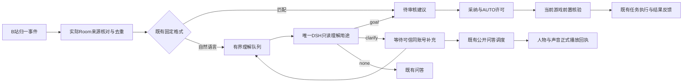

# 观众自然语言建议与澄清

本规范补充[互动闭环](观众建议投票与任务闭环.md)、[来源与撤回](平台事件来源与撤回.md)、[口播链](任务结果与公开口播.md)和[完整总计划](12-一次完整交付总计划.md)。034实现属于同一完整版本的接线；本地协议与受控模型检查不代表真实模型语义质量、MC操作或平台验收。

## 1. 体验和权限

观众可以说“再采八个橡木原木吧”。明确的五类目标产生待审核建议，导播继续按既有采纳、AUTO许可、前置核验和任务回执执行。“弄点木头”应先问种类和数量；回基地只能引用已登记基地；坐标、维度、数量和物品种类不由默认值补齐。普通聊天提交none，继续使用既有问答策略。

同一个可信平台账号可用下一条弹幕补充信息；相同昵称、另一个账号或未知身份均不合并到他人的澄清。导播也可在后台填写具体目标，生成待审核建议。任何这类理解、补全或忽略都不切AUTO、不接受建议、不创建游戏任务。

模型语义识别属于待实测能力。Schema可以拒绝不允许的字段和目标，不能证明模型正确理解中文或消除了所有歧义。真实渠道须覆盖缺数量/泛指物品/代词/否定/玩笑/取消/跨观众/基地不存在/危险目标和提示注入；错误理解继续由建议复核和游戏前置条件拦截。

## 2. 全链路



固定格式优先，已消费的相同平台事件不得再通过自然语言路径重复产生候选。投票、理解记录和游戏任务分别保留自己的状态；“已生成建议”不等于“已采纳”“已执行”或“已回答”。

## 3. 端与源码责任

| 责任 | 实现位置 | 约束 |
|---|---|---|
| 平台实际来源 | `backend/platforms`、Room | 当前B站房间、实际comment来源；排除隐藏、测试、屏蔽、伪造和过期消息 |
| 理解记录与队列 | `backend/game/audience-intents.mjs` | SQLite objects；来源摘要、CAS、幂等、截止、取消和来源删除 |
| 既有审核建议 | `backend/game/suggestions.mjs`、`audience-sources.mjs` | 多条补充来源均进入支持明细，保留原审核/核验/执行路径 |
| 唯一模型宿主 | `backend/dsh-bridge/host.mjs` | `audience_intent`用途、全局并发1、公开回应优先、临时会话清理 |
| 公开澄清 | `backend/game/narration.mjs` | 仍用question候选、来源复核、事实变化重写及正式PCM完成收据 |
| 删除联动 | `backend/platforms/privacy.mjs`、来源撤回入口 | 删除所有状态的派生问题/目标/来源引用/账号关联，阻止迟到发布 |
| 操作者 | `web/mc-control.*` | 开关、状态、分页、补全/忽略、配置冲突和显式恢复已保存设置 |

## 4. 配置和容量

`configs/mc-game.example.json`的`audience_intents`默认关闭；初始配置载入后，既有game数据库保存配置和revision。旧配置缺少该字段时按默认值补齐，不另建数据库或Humanity写入者。

| 参数 | 默认及边界 | 含义 |
|---|---|---|
| enabled | false | 后台明确启用；不启动游戏/模型或授予控制 |
| min_interval_ms | 1000；1000–10000 | 同一理解服务发起调用的最小间隔 |
| max_call_ms | 8000；1000–30000 | 本次调用信号截止；仍受原消息截止约束 |
| pending | 最多16条 | pending/interpreting/clarification共用容量 |
| retained | 最多512条 | 已结束记录按24小时或容量清理；不删除仍有效记录来接收新项 |
| sources | 每项最多4条 | 仅实际可信同账号补充，保留最早消息的30秒截止 |
| source age | 30秒 | occurred_at与received_at分别核对；未来偏差最多2秒 |
| context | 库存最多64项 | 明示截断；其他工具和总上下文沿用宿主有界预算 |
| model | 全局并发1、512输出tokens、最多6轮 | 与既有DSH共享串行调度；公开回应可打断理解 |

来源支持容量复用`SUPPORT_LIMITS`，不新增独立上限。队列满时本次理解不受理，普通显示/问答按原规则处理；不延长消息有效期、不抢占游戏许可。当前容量下的真实吞吐、排队时延和SQLite/Room负载仍需联合压力验收。

## 5. 数据与状态

Schema为[game.schema.json](contracts/game.schema.json)中的AudienceIntentConfig、AudienceIntentResult、AudienceIntent、AudienceIntentDecision、AudienceIntentPage和AudienceIntentStatus。协议示例见[examples.json](contracts/examples.json)，HTTP见[openapi.json](contracts/openapi.json)。

理解记录保存ID/revision、房间、world_id/world_session_id/bridge_boot_id、source_event_ids、source_hash、房间内账号摘要、状态、问题/目标、suggestion_id、原因及创建/更新/截止时间。数据库不复制原观众文字；模型调用前从实际Room来源重新读取。问题和目标本身也可能含派生内容，来源删除时必须清除。

| 状态 | 进入原因 | 后续 |
|---|---|---|
| pending | 受理真实有效来源 | 等待模型或人工处理 |
| interpreting | 单一模型调用开始 | 复核来源与世界后保存结果 |
| clarification | 缺少信息 | 询问、同账号补充或人工补全；截止不续期 |
| superseded | 同账号有效补充被新记录接收 | 原澄清结束，新记录保留全部来源 |
| proposed | 严格goal产生或人工补全 | 关联待审核suggestion；没有任务权限 |
| ignored | 模型分类为普通聊天 | 既有聊天链独立处理 |
| failed | 模型/格式/预算/清理失败 | 不产生候选；可请观众重新提出 |
| cancelled | 人工忽略、关闭、来源/上下文失效、重启 | 取消在途调用，迟到结果不发布 |
| expired | 原消息截止到达 | 不补提议、不延长截止 |

来源删除、改文、过滤或账号删除，对已完成的proposed/clarification等记录也清除派生字段与关联身份。已经真实发生的游戏效果和正式已播事实按其原有审计保留，不能借删除伪造成“从未执行”或自动回滚世界。

## 6. DSH用途与临时会话

`audience_intent`只注册`game_get_state`、`game_query_inventory`、`game_get_recipe`、`game_check_action`和内部结果工具`stream_audience_intent_result`。它不注册游戏动作、视觉、声音、记忆读写、shell或代理工具。只读工具可以被调用；并不要求模型每次都完成全部查询。目标的实际游戏可行性继续在既有dispatch核验。

内部结果必须严格为以下一种，额外字段拒绝：

```json
{"kind":"goal","goal":{"skill":"gather","item_id":"minecraft:oak_log","count":8},"question":null}
```

```json
{"kind":"clarify","goal":null,"question":"想采哪一种木头、采多少个？"}
```

```json
{"kind":"none","goal":null,"question":null}
```

同一调用最多提交一次。仍使用已发布人格，但本用途不请求观众/公共长期记忆快照，不将临时输入写入长期记忆。会话使用受约束的`mc-intent-UUID`名称；正常、错误、取消都在agent释放后删除实际会话体。宿主启动会清理该前缀的中断残留。清理失败时本次调用抛错并阻止后续理解，后台不得获得一个未经清理即发布的“成功”结果。

公开口播仍由`speech`用途执行，它依据已绑定的实际观众身份使用原有记忆规则；理解用途的无记忆约束不改变公开问答的归属。这两种用途在同一个宿主内串行，不增加第二套人格循环。

## 7. HTTP、后台与并发

| 接口 | 输入/输出 | 行为 |
|---|---|---|
| GET `/api/dsh/game/audience/intents` | limit/cursor → AudienceIntentPage | 仅当前房间及世界会话；有界分页 |
| POST `/api/dsh/game/audience/intents/{id}/decision` | request_id、expected_revision、action | resolve必须携带Goal；dismiss不带Goal |
| POST `/api/dsh/game/config` | expected_revision、patch.audience_intents | 复用配置CAS及持久化 |
| SSE audience_intent | 理解记录变化 | 后台刷新；世界/房间变化清除旧列表 |

决策先检查幂等和revision，再检查开放状态、实际来源、新鲜游戏上下文、启用状态及截止。resolve把建议及关联记录放在同一事务，提交后发布事件；相同request_id和内容重放返回原结果，改内容冲突。人工补全期间旧模型结果到达也不能覆盖人工决定。

后台用普通表单填写物品/数量/用途/坐标/基地，没有原始JSON编辑器；数量和坐标初始为空。状态文案明确区分“等待补充”和“已生成待审核建议”。所有来源派生文字只作为文本显示。未保存开关不被SSE刷新覆盖；旧版本保存冲突后可明确恢复最新已保存设置。

页面和API继续遵循项目的无应用鉴权约定。此约定与B站实际采集身份、模型渠道协议、游戏本地许可是不同层的责任，不允许用弹幕文字冒充平台身份或控制权限。

## 8. 回应与失效核对

question候选在其对应理解pending/interpreting时暂等；真实模型不可用时不形成无限等候。澄清或目标产出后，把结构化状态加入既有问答事实快照，并明确不能声称建议已执行。事实变化沿用有界重写及原截止，未新增播放消费者或声音权威。

正式“已回答”仍要求有效播放权下的实际人声PCM完成收据。模型生成、澄清问题落库、创建suggestion和媒体排队均不提前确认。来源撤回、过滤、房间/世界/桥启动改变、断线/过期、禁用、维护锁、截止和人工忽略均阻止在途理解落入当前候选。

## 9. 验证与仍待完成

034的专项检查覆盖来源/去重、澄清跟进、跨账号隔离、无动作权限、撤回/改文/断线/关闭/截止/房间/维护锁、CAS/幂等、重启、正式音频确认、浏览器表单/冲突/安全文本/390宽度和原生DSH实际会话删除。受控HTTP模型只证明宿主接线和取消/清理，不证明实际渠道的中文理解或游戏效果。

最终结果与首次失败以[实现进度](实现进度.md)、[034证据](../../evidence/mc-runtime-round-034.json)为准。真实语义样本、SC/角色/表情/撤回、满队列真实时延、跨进程隐私/崩溃恢复、真实MC建议执行与公开口播及独立观众验收均仍属于D05/D06/D08/D14/D15。
