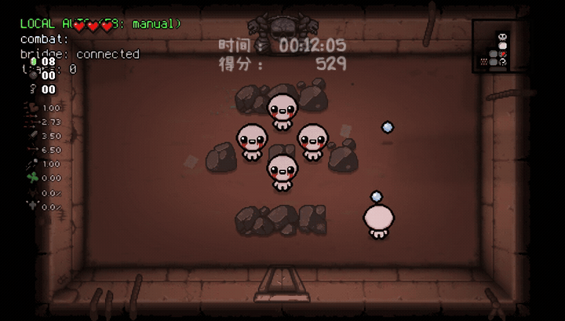
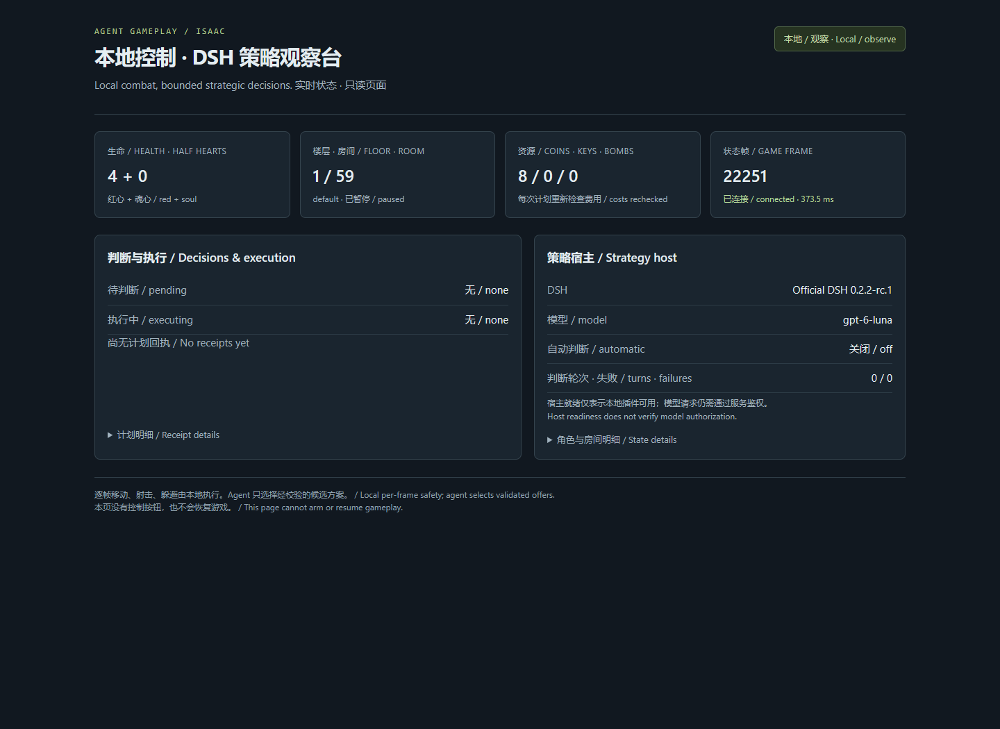
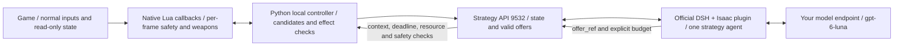

# Agent Gameplay · Isaac

[Final release v0.1.0](https://github.com/wikigsroom/agent-gameplay-isaac/releases/tag/v0.1.0) · [Release notes](docs/releases/v0.1.0.md)

**Native Windows automation for The Binding of Isaac: Repentance. Local code handles real-time control; one agent in DSH handles strategic choices that can tolerate deliberation.**

[中文](README.md) · [Documentation](docs/README.md) · [Architecture](docs/ARCHITECTURE.md) · [Capabilities](docs/CAPABILITIES.md) · [Validation](docs/VALIDATION.md) · [Operations](docs/OPERATIONS.md)

Version: **native130-dsh / 0.1.0**. Tested with **Repentance 1.7.9b, 32-bit `isaac-ng.exe`**, native CPython 3.13.1, Node 24.22.1 and official DSH 0.2.2-rc.1. Other game builds, Repentance+, Linux and macOS are unverified.

## Current usability

| Layer | Verified behavior | Limits |
|---|---|---|
| Local real-time controller | Normal movement, shooting, charge/release, dodging, navigation, spike timing and bomb evacuation; this audit recorded five rooms in real gameplay | Rule coverage is incomplete. Health fell from 6 to 4 half-hearts in the 45-second sample; this is not evidence of reliable full-run completion |
| DSH plugin | Official host, one agent, four tools, short-reference binding, context and budget checks | A ready host does not establish model endpoint availability |
| Model strategy | Earlier gateway tests completed a coin pickup and a room transition with effect receipts; 9/12 replay domains submitted legal plans within 45 seconds | The immediate check after gateway migration returned 401. See validation for the latest retest. Submission legality is not decision quality or win rate |
| Saves and lifecycle | Only authorized slot 3; observation on startup; explicit arming; acknowledged normal pause; original save hash checks | Establish a machine-specific baseline. Actual `ReadOnly=false` is required. The launcher never chooses or overwrites a slot |
| Regression | 606 Python/Lua tests and four independent Node binding tests | Unit tests, model replay and natural live gameplay are reported separately |

The real-time path does not call Jev. No local GPU, Docker, WSL or VM is required. DSH and the game controller run locally; inference runs on the service you configure. **Local-only mode makes no model calls.**

## Real screenshots and recording

These are actual native game framebuffer captures. The GIF is an original-speed excerpt, not generated footage.



[Full MP4 recording](docs/media/local-gameplay.mp4) · [Game screenshot](docs/media/gameplay-local.png) · [Media provenance and checksums](docs/media/README.md)

The recording uses **local-only mode**, showing exploration, room transitions and combat. It does not demonstrate a DSH decision on the newly migrated gateway or a completed run. Some samples had the game in the foreground; other consecutive samples demonstrate background frame advancement.



## How it works



Local code continues combat and hazard handling. The model never emits per-frame direction keys. At a meaningful strategic opportunity, the service constructs executable offers with health, inventory, resources, room context and known mechanics. DSH fetches and binds that decision before inference. The agent chooses a short reference such as `A1` or `A2`; the plugin resolves it to the exact context and an idempotent plan. Local code revalidates the plan and executes normal game input.

**The default 45 seconds is a deadline for an individual strategic opportunity. It is not a fixed polling interval, and pickup/navigation decisions are not requested every 300 ms.** Configure the deadline between 5 and 60 seconds. Non-emergency combat actives can be considered while local combat continues. Emergency survival cannot wait for a model. Spike phases, charge release and dodging stay local. Expired decisions and decisions from a different room cannot authorize input.

| Decision domain | Agent responsibility | Local responsibility | Current scope |
|---|---|---|---|
| 1. Active items | Spend charge or retain it | Charge, player state, normal active input and effect checks | Registered mechanics; active slot 0 only; emergency survival stays local |
| 2. Single-use, reroll and teleport actives | Use versus preserve, including build disruption | Safe-room admission, inventory identity and one-shot input | Known subset including D6/D20/D100; unsupported dash/complex aiming excluded |
| 3. Pickups and combinations | Item tradeoffs, option groups, active replacement and prices | Pathing, real payment, target identity and pickup effects | Full inventory is observable; this is not an exhaustive synergy database |
| 4. Pills | Whether an identified effect is appropriate | Identification/support checks and pocket input | Unknown pills are not revealed in advance; pocket slot 0 only |
| 5. Tarot cards and runes | Immediate value versus preservation | Item identity, normal input, invalidate plans after teleport | Known subset; dangerous/unknown effects excluded |
| 6. Room and floor routing | Next room, exploration order and resource reservation | Door/terrain navigation, combat and normal exits | Discovered map and history; executable does not mean optimal |
| 7. Angel/devil deals | Build benefit versus health cost | Payment semantics, surviving reserve and target identity | Known ordinary-Isaac health semantics first; unknown costs rejected |
| 8. Bomb entry | Bomb budget and expected value | Placement, normal bomb input and evacuation | Existing executable offers only; hidden-room metadata advantage disclosed below |
| 9. Planetarium | Enter a discovered room or conserve keys | Locked-door payment and approach path | Skipping a treasure room does not guarantee a planetarium |
| 10. Dice rooms | Trigger or decline the visible die | Read face, approach trigger, detect reset | Known faces 1–6; limited natural live coverage |
| 11. Sacrifice rooms | Whether one more payment is worthwhile | One payment, verify count, request a new decision | Known count and ordinary Isaac; no unattended repeated sacrifice |
| 12. Special terrain | Detour, admission and resource commitment | Per-frame spike phase, hazard prediction and crossing timing | The agent does not time crossings on a millisecond scale |

See the [capability matrix](docs/CAPABILITIES.md) for deadlines, triggers and evidence. Every domain has a supported subset; this is not universal support for all characters, items or room layouts.

## Install on a new machine

### 1. Native prerequisites

Provide a game installation you are entitled to use, 64-bit Windows, **CPython 3.13** and **Node >=24.9**. The tested runtime versions are Python 3.13.1 and Node 24.22.1. CUDA and a GPU model are unnecessary. Installation does not change system script policy or use containers.

```powershell
git clone git@github.com:wikigsroom/agent-gameplay-isaac.git
cd agent-gameplay-isaac
python -m pip install -r requirements-native.lock.txt
Copy-Item config/decision_provider.example.json config/decision_provider.json
python -B -X utf8 setup_dsh.py
```

DSH installs from the committed lockfile using `npm ci --ignore-scripts`. If PATH resolves an older Node, or npm is installed separately, supply native paths:

```powershell
python setup_dsh.py --node "C:\path\to\node.exe" --npm "C:\path\to\npm\bin\npm-cli.js"
```

### 2. Back up saves and configure the installation

Exit the game normally first. Replace all example paths below. Repeat `--protected-root` for original Steam `250900` or other directories. Protected roots must be separate from the writable test save area.

```powershell
python configure_install.py --game-root "E:\Games\Isaac" --save-root "C:\Users\YOUR_USER\Documents\My Games\Binding of Isaac Repentance" --protected-root "D:\Steam\userdata\YOUR_ID\250900" --backup-root "E:\Backups\Isaac"
```

The helper copies complete source directories, including empty directories, and verifies SHA-256 before creating machine configuration and the baseline. Sources are unchanged and existing machine configuration is never overwritten. Only specifically recognized slot-3 files in the writable test area are excluded from the protected baseline. All `.dat` files in separate protected roots, including their slot-3 files, remain protected. Existing slot-3 data is rejected by default. Use `--allow-existing-slot3` only when that slot is explicitly authorized for testing; it does not erase or recreate anything.

While the game is closed, check its actual `options.ini`:

```ini
EnableMods=0
EnableDebugConsole=0
PauseOnFocusLost=0
SteamCloud=0
```

The six `mods/IsaacJev/` source files are reused by a `--luadebug` native bridge that installs **normal-input callbacks in memory**, without `RegisterMod`. **Do not additionally enable IsaacJev in the game's Mod menu. No separate Jev/EID Mod is required.** The controller does not spawn damage, change character stats, edit rooms, grant unlocks or write saves. The game determines progression eligibility; actual `ReadOnly=false` is checked before arming.

```powershell
python sync_mod_sources.py --version native130
```

### 3. Configure the model

```powershell
python configure_model.py --base-url "https://YOUR_GATEWAY/v1" --model gpt-6-luna
python probe_model.py
```

The API key is entered without echo and stored in `private/model.json`; the local bridge token is also private. The gateway must support OpenAI-style chat, tool calls and streaming. A basic probe is necessary but does not replace testing the actual official DSH tool loop. Never put keys in command arguments, documentation or commits. The example endpoint is not a public service.

### 4. Start, observe, arm and pause

```powershell
python launch_game.py
# Wait for loading. Select only the authorized slot 3 in normal menus and enter a room.
python manage_stack.py start
python manage_stack.py status
```

`start` enters observation mode and confirms normal game pause. A DSH cold start can take several minutes; the launcher waits up to 300 seconds. Restarting services never automatically resumes gameplay. The read-only monitor is **http://127.0.0.1:9532/**. No browser is opened automatically.

After confirming the intended slot, choose one mode:

```powershell
python manage_stack.py arm        # Local real-time control + DSH strategy
python manage_stack.py arm-local  # Local-only; DSH automatic decisions disabled
```

```powershell
python manage_stack.py pause      # Require actual pause and a stable frame acknowledgement
python manage_stack.py stop       # Pause first, then stop this stack
python manage_stack.py restart    # Restart into observation, without automatic resume
```

Both modes verify process identity, authorized writable slot 3, original save hashes and a living player. Old process IDs are not authorization. The PowerShell wrapper is optional. If system policy blocks scripts, use these Python commands without changing policy. Do not run the legacy autopilot or supervisor alongside this stack.

## Plugin and interfaces

| Tool | Purpose |
|---|---|
| `isaac_get_decision` | Read and bind valid offers, remaining time and context |
| `isaac_get_state` | Query 13 topics including health, inventory, effects, map, room, resources, enemies and bosses |
| `isaac_lookup` | Look up versioned local collectible/card/domain rules; unknown remains unknown |
| `isaac_submit_plan` | Submit a short offer reference, rationale, four explicit resource budgets and optional execution deadline |

The plugin is in [dsh-host/isaac-plugin](dsh-host/isaac-plugin/README.md). It can be packed into a tgz, but requires this project's state/execution service. It rotates short sessions every four turns; local state retains run history. The agent has no terminal, file-write, arbitrary Lua, console or arbitrary-key tool. See [architecture](docs/ARCHITECTURE.md) for API contracts and extension steps.

## Verification and limitations

```powershell
python -B -X utf8 -m unittest discover -s tests -q
node --test tests/test_dsh_binding.mjs
python check-saves.py
```

Model replay validation owns port 9532. Pause and stop live services before running a separate DSH host and replay verifier; never run them alongside the real controller. See [operations](docs/OPERATIONS.md).

- Sub-second reactions stay local. Earlier successful model replay submissions took about 6.9–33.2 seconds, unsuitable for frame-by-frame control.
- Only active/pocket slot 0 executes. Other slots are observable. Complex character health, unknown payment semantics, unidentified pills and unregistered effects are conservatively excluded.
- Map queries filter undiscovered rooms, but **legacy bomb-wall candidates use engine metadata about adjacent hidden rooms**. This is privileged information and must not be described as blind visual play.
- `observed` means replay validation only; `accepted` means queued; `succeeded` requires relevant state-change evidence. These are different claims.
- No multi-seed, multi-run A/B study has established a significant win-rate or decision-quality advantage over local control. Natural samples of rare rooms remain incomplete.

## Repository and attribution

`src/isaac_jev/` contains local control and the strategy service; `mods/IsaacJev/` contains game-side source; `dsh-host/isaac-plugin/` is the DSH plugin; `tests/` contains regressions and labelled replays; `docs/` contains bilingual guides, reviewed media and sanitized evidence. Credentials, saves, raw sessions, dependencies, runtime data and unused experimental weights are excluded.

This project builds on [chongchong59699/isaac-jev](https://github.com/chongchong59699/isaac-jev), retaining the MIT license and original attribution. The `isaac_jev` and `IsaacJev` names remain for compatibility. Game files and artwork are not distributed as software assets; recordings are gameplay demonstrations. Supply your own game. Dependencies retain their own licenses. See [LICENSE](LICENSE), [CHANGELOG](CHANGELOG.md), [contributing](CONTRIBUTING.md) and [security](SECURITY.md).

## Optional GPU trajectory distances

An existing native Windows CUDA/PyTorch environment can batch the nine-direction swept-distance calculations. CPU remains the default. No model is loaded; DSH decisions, ordinary inputs and save protection are preserved. See [GPU setup, failure and validation boundaries](docs/GPU_GEOMETRY.md).
