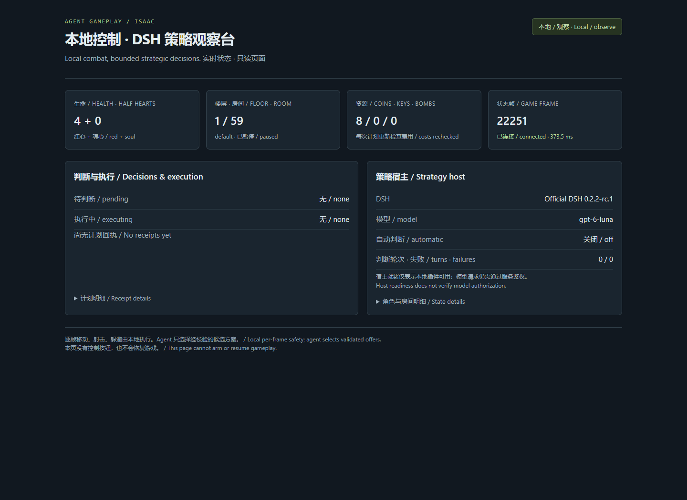
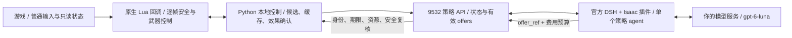

# Agent Gameplay · Isaac

[正式版 v0.1.0](https://github.com/wikigsroom/agent-gameplay-isaac/releases/tag/v0.1.0) · [发布说明](docs/releases/v0.1.0.md)

**以撒 Repentance 的原生 Windows 自动游玩系统：本地负责实时控制，DSH 中的单个 agent 负责慢速策略选择。**

[English](README.en.md) · [文档导航](docs/README.md) · [架构与接口](docs/ARCHITECTURE.md) · [能力边界](docs/CAPABILITIES.md) · [验证与证据](docs/VALIDATION.md) · [操作与排障](docs/OPERATIONS.md)

当前版本 **native130-dsh / 0.1.0**。实测游戏 **Repentance 1.7.9b，32 位 `isaac-ng.exe`**；原生 CPython 3.13.1、Node 24.22.1、官方 DSH 0.2.2-rc.1。其他游戏版本、Repentance+、Linux/macOS 尚未验证。

## 实际可用情况

| 层次 | 已验证内容 | 使用边界 |
|---|---|---|
| 本地实时控制 | 普通输入移动、射击、蓄力释放、躲弹、路线、地刺与炸弹撤离；本次真实录制经过 5 个房间 | 规则系统有覆盖盲区；本次 45 秒样本生命由 6 降到 4 半心，不能据此声称稳定通关 |
| DSH 插件 | 官方宿主、单 agent、4 个工具、短编号绑定、上下文与预算复核 | 宿主就绪不等于模型接口可用 |
| 模型与策略 | 此前在指定网关完成硬币拾取、换房及效果回执；12 类回放曾有 9/12 在 45 秒内合法提交 | 新网关切换后的即时检查返回 401；当前状态与后续复测见验证报告。合法提交率不代表决策质量或通关率 |
| 存档与生命周期 | 只操作授权的第 3 槽；启动观察；显式启用；真实暂停确认；原存档哈希校验 | 不替用户选择或覆盖存档；必须建立本机基线，实际 `ReadOnly=false` 才允许启用 |
| 回归 | 606 项 Python/Lua 测试；4 项独立 Node 绑定测试 | 回放、模拟环境与自然实机证据分别记录 |

本版本的实时链路不调用 Jev，也不要求本地 GPU、Docker、WSL 或虚拟机。DSH 和游戏控制在本机运行，模型推理由你配置的服务承担；**选择纯本地模式时没有模型调用**。

## 实机截图与录制

下图来自当前版本的真实游戏原生帧缓冲，GIF 为原速片段，未生成或伪造游戏画面。


[完整游戏录制 MP4](docs/media/local-gameplay.mp4) · [游戏截图](docs/media/gameplay-local.png) · [素材时间、模式与校验信息](docs/media/README.md)

该录制运行于 **纯本地模式**，展示探索、换房与战斗。视频没有展示本次新网关的 DSH 判断，也没有展示一局通关。部分采样窗口游戏曾处于前台，另有连续后台帧推进，详见证据。



## 方案如何工作



本地控制持续处理即时战斗和危险，模型不会逐帧发方向键。出现有意义的策略机会后，本地构造可执行候选，附上生命、背包、资源、房间与机制信息。DSH 预取并绑定这一轮决策，agent 从 `A1`、`A2` 等候选中选择。插件将短编号恢复为真实上下文和幂等计划，再由本地执行器复核并转为普通游戏输入。

**默认 45 秒是一次策略机会的判断期限，不是每 45 秒固定调用，也不是每 300 ms 重新做拾取/导航判断。** 可配置为 5–60 秒。非紧急主动可以在本地继续战斗时判断；需要立即保命的动作不能等待模型。地刺相位、蓄力时机与躲弹始终留在本地。超时或换房后旧授权失效。

| 决策种类 | Agent 判断什么 | 本地负责什么 | 当前支持边界 |
|---|---|---|---|
| 1. 主动道具 | 是否值得消耗充能、何时保留 | 充能、角色状态、普通主动键及效果核验 | 已登记机制；只执行主动槽 0；紧急保命不依赖模型 |
| 2. 一次性/重骰/传送主动 | 使用与保留、构筑损失 | 安全房间、库存身份、一次性输入 | D6/D20/D100 等已知子集；冲刺/复杂瞄准不开放 |
| 3. 拾取与组合 | 取舍、选项组、主动替换、商店价格 | 寻路、实际支付、目标身份、拾取效果 | 能读完整背包；不是完整协同知识库 |
| 4. 药丸 | 已识别效果是否适用 | 检查识别状态、支持表、口袋输入 | 不预揭示未知药丸；只执行口袋槽 0 |
| 5. 塔罗牌/符文 | 即时收益与保留价值 | 卡牌身份、普通使用、传送后失效旧计划 | 已知子集；危险或未知效果拒绝 |
| 6. 房间/楼层路线 | 下一房间、探索顺序与资源保留 | 门与地形寻路、战斗、正常出口 | 已发现地图及历史；选中可走路线不等于路线最优 |
| 7. 天使房/恶魔房 | 构筑收益、生命交易取舍 | 费用语义、支付后余量、目标一致性 | 先支持普通 Isaac 已知生命类型；未知费用拒绝 |
| 8. 炸弹开路 | 炸弹预算与收益 | 放置点、普通炸弹键、爆炸撤离 | 仅已构造且可执行的候选；存在隐藏房元数据优势，见下文 |
| 9. 星象房 | 已发现房间是否值得进、是否保留钥匙 | 锁门支付与门口路径 | 跳过宝箱房不保证生成星象房 |
| 10. 骰子房 | 根据点数决定是否触发 | 读可见点数、走上机关、检测重置 | 已知 1–6 点；自然实机覆盖不足 |
| 11. 献祭房 | 当前收益是否值得再付一次血 | 只付一次、核对计数、重新判断 | 已知计数和普通 Isaac；不自动连续献祭 |
| 12. 特殊地形 | 是否绕行、进入、投入资源 | 每帧地刺相位、危险预测、通行时机 | Agent 不承担几十毫秒级穿刺控制 |

12 类的期限、触发条件、控制职责和测试覆盖详见 [能力矩阵](docs/CAPABILITIES.md)。这里的“支持”均指子集，不表示所有道具、房型和角色已覆盖。

## 新机器安装

### 1. 准备原生运行环境

准备有权使用的游戏安装、原生 Windows 64 位、**CPython 3.13** 和 **Node >=24.9**。本次验证版本为 Python 3.13.1 / Node 24.22.1。不需要 CUDA 或 GPU 模型。安装过程不更改系统执行策略、不使用容器。

```powershell
git clone git@github.com:wikigsroom/agent-gameplay-isaac.git
cd agent-gameplay-isaac
python -m pip install -r requirements-native.lock.txt
Copy-Item config/decision_provider.example.json config/decision_provider.json
python -B -X utf8 setup_dsh.py
```

DSH 使用仓库锁文件和 `npm ci --ignore-scripts` 安装。如果 PATH 中的 Node 过旧或 npm 不在同一目录，可指定原生路径：

```powershell
python setup_dsh.py --node "C:\path\to\node.exe" --npm "C:\path\to\npm\bin\npm-cli.js"
```

### 2. 建立本机存档备份与配置

先正常退出游戏。以下是路径示例，必须换成自己的安装与真实存档目录。`--protected-root` 可重复传入，用于额外保护原 Steam `250900` 等完整目录；它必须与本次可写测试区分开。

```powershell
python configure_install.py --game-root "E:\Games\Isaac" --save-root "C:\Users\YOUR_USER\Documents\My Games\Binding of Isaac Repentance" --protected-root "D:\Steam\userdata\YOUR_ID\250900" --backup-root "E:\Backups\Isaac"
```

脚本复制整个来源目录和空目录，核验 SHA-256，再创建本机配置与基线。来源不修改，已有配置不覆盖。可写测试区只排除明确的第 3 槽数据；额外保护区的所有 `.dat`（包括它的第 3 槽）仍受保护。已有第 3 槽时默认拒绝；仅在已确认该槽就是授权测试槽时使用 `--allow-existing-slot3`，它不会清空或重建存档。

游戏关闭时在对应 `options.ini` 核实：

```ini
EnableMods=0
EnableDebugConsole=0
PauseOnFocusLost=0
SteamCloud=0
```

这套方案保留六个 `mods/IsaacJev/` 源文件，使用 `--luadebug` 与原生桥在内存中加载**普通输入回调**，不执行 `RegisterMod`。因此 **不要在游戏 Mod 菜单额外启用 IsaacJev，也不需要另装 Jev/EID 等 Mod**。它不生成伤害、不修改角色属性、房间、解锁或存档。最终解锁资格仍由游戏判断，启动前必须核实实际 `ReadOnly=false`。

```powershell
python sync_mod_sources.py --version native130
```

### 3. 配置模型

```powershell
python configure_model.py --base-url "https://YOUR_GATEWAY/v1" --model gpt-6-luna
python probe_model.py
```

密钥通过隐藏输入保存到 `private/model.json`，本机桥 token 也在 `private/`。模型网关需要支持 OpenAI 风格对话、工具调用及流式响应；基础探测通过后，仍须测试官方 DSH 实际工具链。不要把密钥写进命令参数、README 或提交记录。示例服务地址不是可用公共服务。

### 4. 启动、观察、启用与暂停

```powershell
python launch_game.py
# 等待载入，在普通菜单选择已授权的第 3 槽，进入正常房间。
python manage_stack.py start
python manage_stack.py status
```

`start` 默认观察并确认游戏暂停；DSH 冷启动可能需要数分钟，最多等待 300 秒。它不会因为服务重启自行恢复游戏。只读页面为 **http://127.0.0.1:9532/**，不会自动打开浏览器。

确认继续这一槽后，选择一种模式：

```powershell
python manage_stack.py arm        # 本地实时控制 + DSH 策略
python manage_stack.py arm-local  # 纯本地控制，关闭 DSH 自动判断
```

```powershell
python manage_stack.py pause      # 等待真实暂停、稳定帧确认
python manage_stack.py stop       # 先暂停，再停止本套服务
python manage_stack.py restart    # 重启后仍然观察，不自行继续
```

两种模式都校验进程身份、授权第 3 槽、实际可写状态、原存档哈希与存活角色。不要把旧进程号当作授权。PowerShell 包装脚本为可选入口；系统策略阻止脚本时，直接使用上述 Python 命令，无需改变策略。不要同时启动旧版 autopilot 或监督器。

## 插件、接口与可扩展性

| 工具 | 用途 |
|---|---|
| `isaac_get_decision` | 取得并绑定当前有效候选、剩余期限和上下文 |
| `isaac_get_state` | 查询生命、背包、效果、地图、房间、资源、敌人、boss 等 13 个主题 |
| `isaac_lookup` | 查询本地版本化道具、卡牌、领域规则；未知保持未知 |
| `isaac_submit_plan` | 提交候选短编号、理由、四项显式资源预算和可选执行期限 |

插件位于 [dsh-host/isaac-plugin](dsh-host/isaac-plugin/README.md)，可独立打包为 tgz，但必须配合本项目的状态/执行服务。每四轮轮换短会话，长期局内状态保存在本地缓存。Agent 没有终端、文件写入、任意 Lua、控制台或任意按键工具。接口及扩展步骤见 [架构](docs/ARCHITECTURE.md)。

## 验证与局限

```powershell
python -B -X utf8 -m unittest discover -s tests -q
node --test tests/test_dsh_binding.mjs
python check-saves.py
```

模型回放验证会独占 9532，必须先在暂停状态停止服务，再单独启动 DSH 宿主和回放验证，不能与真实控制器并行。具体步骤见 [操作说明](docs/OPERATIONS.md)。

- 需要几百毫秒内反应的控制始终由本地承担；此前模型成功回放耗时约 6.9–33.2 秒，不能担任逐帧控制器。
- 主动/口袋槽 0 可执行，其他槽可观察；复杂角色生命、未知费用、未知药丸及未登记机制保守拒绝。
- 当前地图查询过滤未发现房间，但**旧开墙候选读取了相邻隐藏房的引擎元数据**，有信息优势；不能把相关演示称为纯视觉盲玩。
- 回执 `observed` 只代表回放合法；`accepted` 只代表执行排队；`succeeded` 才有相应状态变化证据。不同层级不能互换。
- 尚未完成跨种子多局 A/B 测试，未证明 DSH 比本地策略有显著通关率或决策质量提升。稀有房间自然样本仍需积累。

## 仓库组织与来源

`src/isaac_jev/` 为本地控制与策略服务；`mods/IsaacJev/` 为游戏侧源码；`dsh-host/isaac-plugin/` 为 DSH 插件；`tests/` 为回归与标注回放；`docs/` 为双语说明、审查后的截图/视频与脱敏证据。运行数据、密钥、存档、完整会话、依赖目录和旧试验权重均不入库。

本项目在 [chongchong59699/isaac-jev](https://github.com/chongchong59699/isaac-jev) 基础上发展，保留 MIT 许可证及原作者署名。`isaac_jev` / `IsaacJev` 名称为接口兼容而保留。游戏及其美术不在本仓库分发，媒体仅为实机演示；需要自行提供游戏。依赖由各自许可证约束。见 [LICENSE](LICENSE)、[变更记录](CHANGELOG.md)、[贡献指南](CONTRIBUTING.md) 与 [安全说明](SECURITY.md)。
